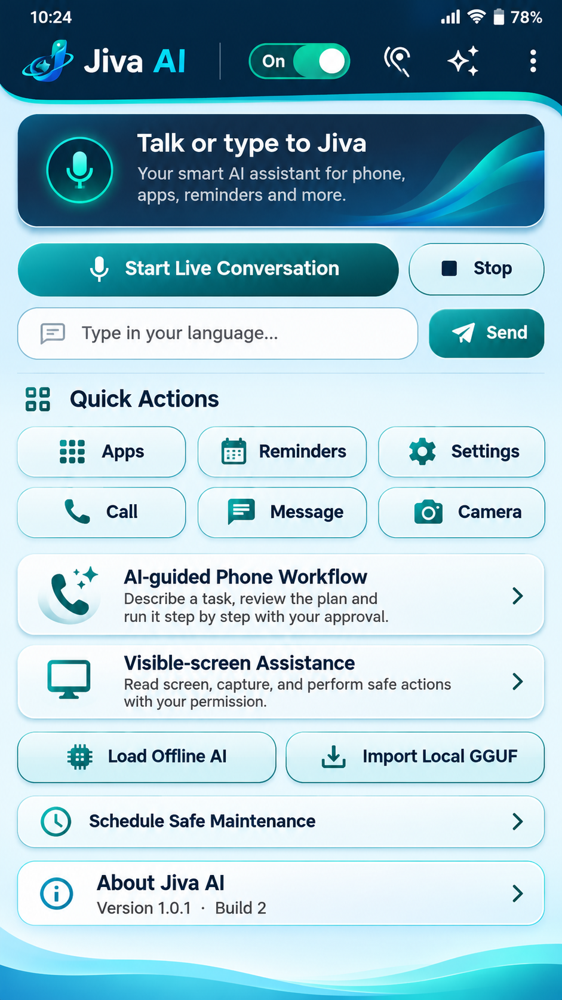
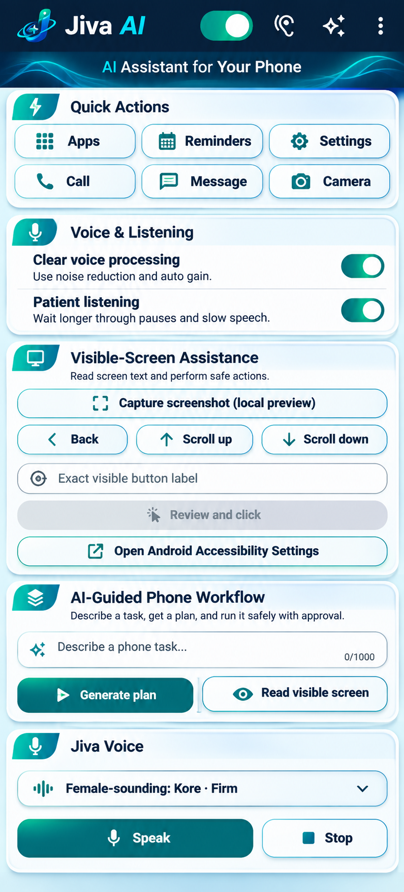
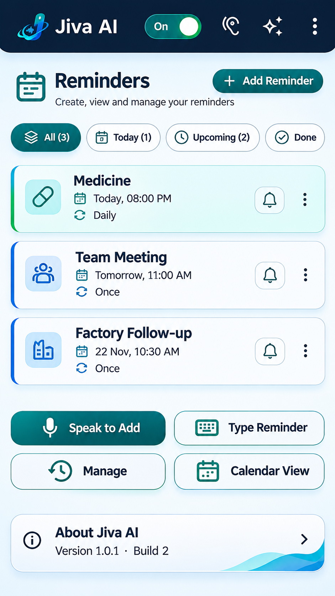

# Jiva AI Assistance

<p align="center">
  
</p>

<p align="center"><strong>A Flutter-first, open-source Android AI assistant with multilingual voice, reminders and permission-based phone assistance.</strong></p>

<p align="center">
  <a href="https://github.com/aiclerksupport-coder/Jiva-AI-Assistance-Android/actions/workflows/source-checks.yml"></a>
  
  
  <a href="LICENSE"></a>
  
</p>

**[Build & install](#build-the-flutter-app)** · **[Features](#what-jiva-can-do)** · **[Safety](#privacy-permissions-and-real-world-limits)** · **[Contribute](CONTRIBUTING.md)** · **[Launch kit](docs/COMMUNITY_LAUNCH_KIT.md)**

> **Status:** Experimental source project; not a verified Play Store product. Flutter package version: **1.0.1+2**. A maintainer has reported a successful Windows release build and installation on one Android phone. That alone does not establish compatibility on other devices or successful completion of all runtime scenarios. There is no verified, general-public APK release linked here.

## Why Jiva?

Jiva aims to make common Android assistant tasks easier through voice and typed commands, while retaining user control. It is **not** an unrestricted phone automation agent.

- **Flutter/Dart-first interface** with a Jiva-branded Material 3 dashboard and Android-specific platform integration.
- **Multilingual voice and typed interaction**; exact speech-language support depends on the device, recognizer and configured provider.
- **Bring your own Gemini API key (optional).** Saving or removing the key requires fresh device authentication on supported Android devices. Provider access, availability and quotas vary.
- **Local commands and reminders** with Android notification and battery-policy limitations.
- **Open apps, prepare calls/messages and navigate supported system screens**, with appropriate handoff, accessibility consent and confirmations.
- **Opt-in screen assistance**, limited to visible, permitted UI and explicit user authorization.
- **Optional wake words / offline AI components**, requiring local setup, compatible models and device resources.

### Preview — approved design direction

These images are **concept mockups**, not captures of the running APK. Actual UI details and availability can differ.

| Dashboard concepts | Settings | Reminders |
| --- | --- | --- |
|  |  |  |

[See all six approved UI references](docs/ui-reference/README.md). For an authentic demo, capture your own phone after reviewing notifications, contacts and secrets.

## Build the Flutter app

**Requirements:** Windows PowerShell, Flutter compatible with Dart >=3.12, Android SDK and ADB, JDK 17, a USB-debugging-authorized Android phone, and an internet connection for initial dependency downloads. The repository includes a Flutter Android host; **do not run `flutter create` over it as a routine setup step.**

Clone:

```powershell
git clone https://github.com/aiclerksupport-coder/Jiva-AI-Assistance-Android.git
cd Jiva-AI-Assistance-Android
```

Inspect the scripts before execution. The project provides a Windows build/test/install pipeline:

```powershell
powershell -NoProfile -ExecutionPolicy Bypass -File ".\BUILD_FULL.ps1"
```

It performs Flutter validation, analysis, tests, APK build and ADB installation, stopping on reported failures. **The script also runs `dart format --output=write`, which may alter source formatting.** See [the build script guide](BUILD_FULL_README.md). APK output, when successful: `flutter/build/app/outputs/flutter-apk/app-release.apk`.

For development from `flutter/`:

```powershell
flutter pub get
flutter analyze
flutter test
flutter run
```

**Do not install APKs from unsolicited forks or unofficial mirrors.** Check the release source, publisher, signing details, Android permissions and checksum before installation. The current build guide documents debug signing for release builds, so this is **not ready for Play Store publication** without release signing and a broader verification process.

## Project structure

| Directory | Purpose |
| --- | --- |
| [`flutter/`](flutter/) | **Primary Flutter/Dart Android application**, Android host and local platform plugin |
| [`app/`](app/) | Separate legacy/native Kotlin Android prototype; not the same APK as the Flutter app |
| [`docs/`](docs/) | Architecture, security boundaries, testing, UI references and launch materials |
| [`backend/`](backend/) | Optional experimental gateway source; **not deployed or required** for the owner's current bring-your-own-key flow |
| [`.github/workflows/`](.github/workflows/) | Repository CI workflows |

## Privacy, permissions and real-world limits

- **Calls/messages:** Jiva prepares actions or opens destination apps; the user reviews and completes them. It must not claim a call or message was sent when only a handoff occurred.
- **Accessibility:** Opt-in service. Visible-screen reading and controlled actions are subject to permission, explicit requests, local restrictions and confirmation; do not use on banking, login, payment or private screens.
- **Microphone/wake word:** May require an Android foreground service and notification. Force-stop, battery restrictions and Android policies can interrupt background listening.
- **AI data:** When Gemini is used, relevant prompts go to Google. Depending on the feature and device, system speech recognition may use third-party or remote processing.
- **Key protection:** The API key uses secure storage and fresh Android biometric/credential authorization for changes; no phone app can promise perfect protection on a compromised device. Gemini Live client-key exposure is a documented MVP risk.
- **Offline:** Some local commands work without connectivity, but Gemini and other provider-backed functionality do not.
- **Safety:** Not designed for emergency, medical, financial or other safety-critical use.

Read [Security](SECURITY.md), [Disclaimer](DISCLAIMER.md), [Terms](TERMS_OF_USE.md), [Phone capabilities](docs/ANDROID_PHONE_CAPABILITIES.md) and [Owner key security](docs/OWNER_ONLY_GEMINI_KEY_SECURITY.md).

## Participate

Found a bug or want to help? Open a [bug report](https://github.com/aiclerksupport-coder/Jiva-AI-Assistance-Android/issues/new/choose), suggest a feature or read [CONTRIBUTING.md](CONTRIBUTING.md). Attach sanitized logs, Android/Flutter versions and reproduction steps. Do not include API keys, contacts, messages, private screens or personal identifiers.

For the public introduction, demo checklist, social copy, repository topics and release readiness gates, see **[Community Launch Kit](docs/COMMUNITY_LAUNCH_KIT.md)**.

## Ownership and license

**Jiva AI Assistance** is an independent software project. **Sanwariya** is a proposed, currently unregistered umbrella brand; no registered-company status or institutional affiliation is claimed. Legal developer/operator: **Kalpesh Chhabhaiya**. See [MIT License](LICENSE); the repository also contains draft legal documents that require professional review before broad public distribution.
